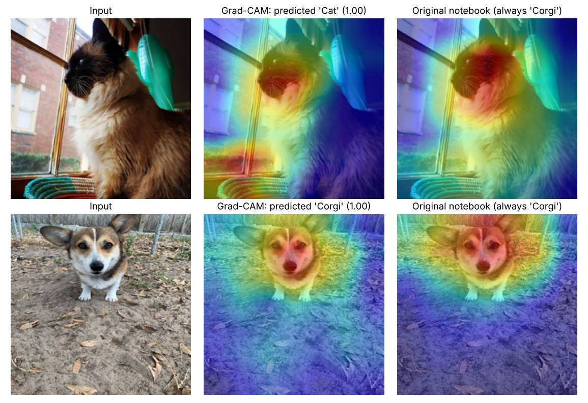

# grad-cam

Grad-CAM explanations for a transfer-learning image classifier (nine dog
breeds and cats), plus a **model-randomisation sanity check** that tests
whether the explanations reflect what the model learned.



*Middle: Grad-CAM for the class the model predicts. Right: what the
project's original notebook produced, which always explained class 2
("Corgi"), weighted only 672 of DenseNet-121's 1,024 channels and ran a
forward pass that differed from the trained model's. For the cat, the
corrected map also puts weight on the basket and window in the lower left, a
hint that the model uses background context.*

## What's here

* **`GradCAM`**: a model-agnostic implementation that hooks any
  convolutional layer. The model runs its own unmodified `forward`, so the
  explanation is always of the prediction it actually makes; any class can
  be explained, not just the top one.
* **Sanity check**: cascading randomisation of the model's weights from the
  output backwards (Adebayo et al., 2018). If a saliency map barely changes
  when the learned weights are destroyed, it is reflecting the input or the
  architecture rather than the model.
* **Classifier**: DenseNet-121 or ResNet backbones pretrained on ImageNet,
  with a new MLP head; train the head only or fine-tune everything.
* **CLI** for training, prediction, explanation and the sanity check.

## Quickstart

```bash
pip install -e ".[dev]"
pytest -q                           # 13 tests, a few seconds on CPU

# Data: one folder per class, e.g. data/pets/Corgi/*.jpg, data/pets/Cat/*.jpg
gradcam train   --data data/pets --out runs/densenet --exclude my_pets
gradcam predict --checkpoint runs/densenet/best.pt photo.jpg
gradcam explain --checkpoint runs/densenet/best.pt photo.jpg                  # predicted class
gradcam explain --checkpoint runs/densenet/best.pt photo.jpg --target Husky   # any class
gradcam sanity  --checkpoint runs/densenet/best.pt photo.jpg other.jpg
```

Use it on your own model:

```python
from gradcam import GradCAM, overlay

with GradCAM(model, "features.norm5") as cam:   # "layer4" for a ResNet
    heatmaps, logits = cam(images)              # or cam(images, target=class_index)
```

## Sanity check result

Running `randomization_test` on the original 2022 checkpoint with the two
images above (five cascading steps, mean Spearman correlation between the
original and randomised heatmaps):

| Randomised (from the output down to) | Spearman ρ |
|---|---|
| classifier head and top of dense block 4 | 0.06 |
| end of dense block 3 | 0.47 |
| middle of dense block 3 | 0.41 |
| dense block 2 | 0.43 |
| the whole network | 0.45 |

Destroying the top layers wipes out the explanation (ρ ≈ 0), so the maps do
depend on the learned head. But once the whole network is random the maps
drift back to ρ ≈ 0.45 with the originals: part of what Grad-CAM shows here
comes from image structure that survives with random weights. That is the
failure mode Adebayo et al. warn about, and a reason to treat saliency maps
as hypotheses, not ground truth. (Two images is a small sample; run it on a
validation set before drawing conclusions.)

## Notes on the rewrite

This replaces two 2022 Colab notebooks. Besides the three Grad-CAM bugs in
the figure caption, the rewrite fixes:

* **Leaked validation accuracy.** Every image was augmented into five
  copies *before* the 80/20 split, so near-duplicates of validation images
  were in the training set. The split is now made on the original files,
  stratified by class, and augmentation happens on the fly.
* **Preprocessing mismatch.** Images were loaded as BGR with raw 0-255
  values and fed to an ImageNet backbone that expects normalised RGB.
* **Broken noise augmentation.** Gaussian noise was cast to `uint8`, so
  values below -1 wrapped around to 254-255 (bright speckles).
* **Sideways photos.** Phone pictures with an EXIF orientation flag are now
  rotated upright before use.

The dataset (web images) and trained weights are not in the repository. To
share a trained model, attach `best.pt` to a GitHub Release.

## References

* Selvaraju et al. (2017), *Grad-CAM: Visual explanations from deep networks via gradient-based localization*
* Adebayo et al. (2018), *Sanity checks for saliency maps*
* Huang et al. (2017), *Densely connected convolutional networks*
